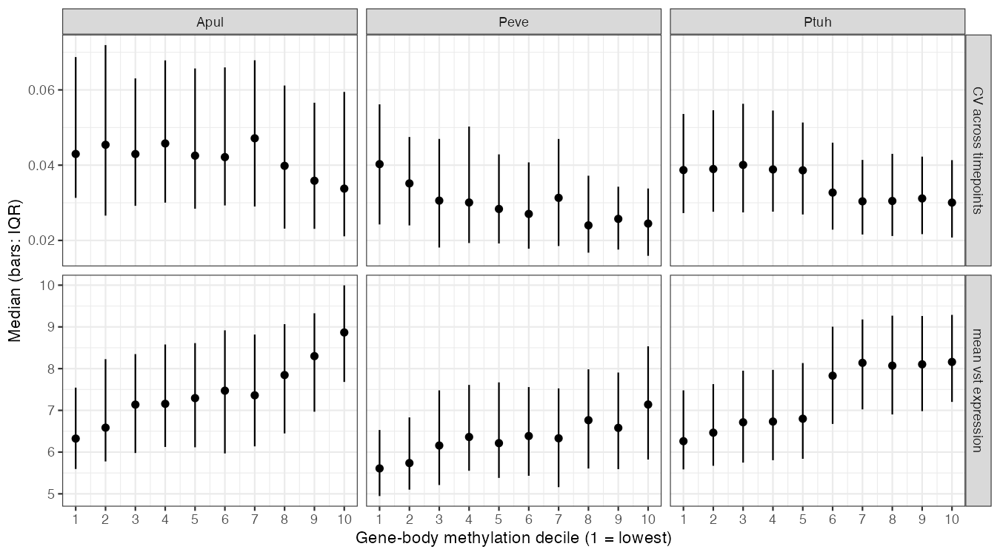
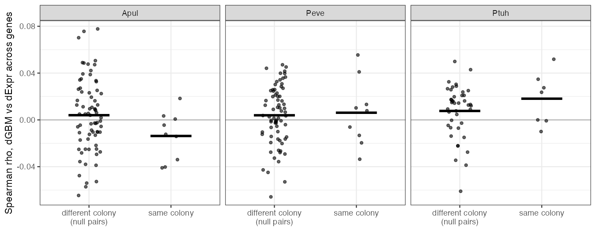
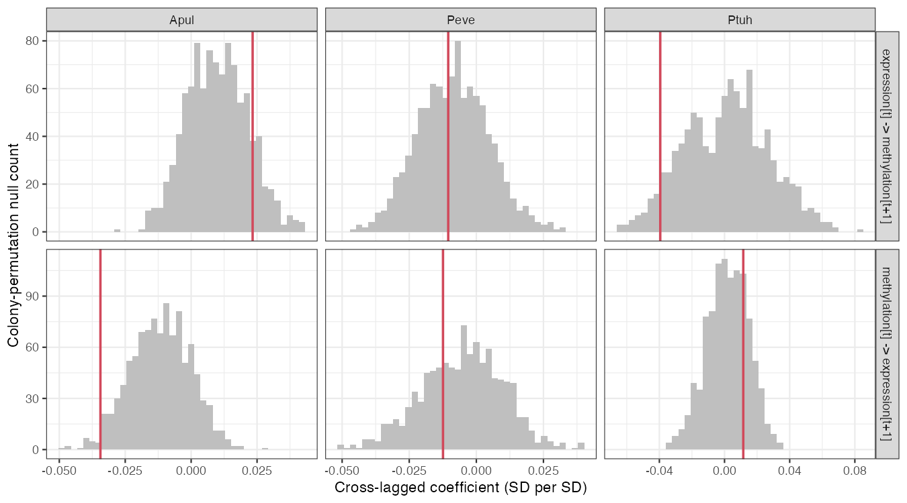
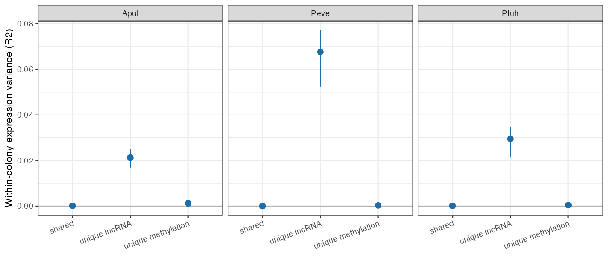
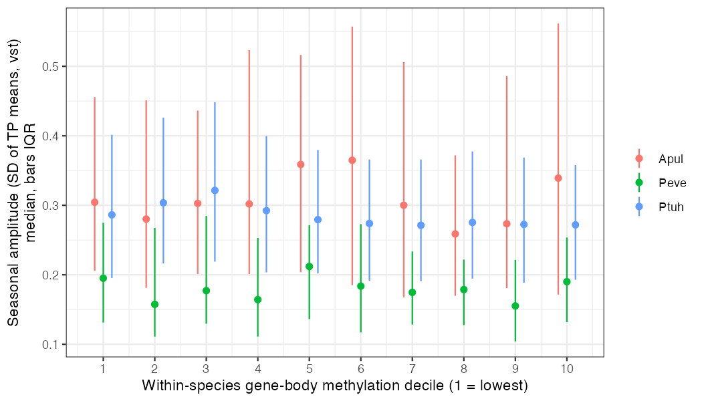
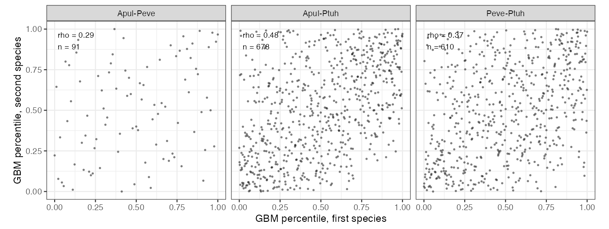

::: {.callout-warning}
## Status

This report is a Roberts Lab working manuscript. It has not been peer reviewed.

It is shared to make small scientific efforts, preliminary analyses, technical
observations, and exploratory work openly available.
:::

## Abstract

Is gene-body methylation (GBM) in corals a stable mark of constitutively
expressed genes, or a regulator that shifts expression with season? Six
pre-registered hypotheses (H04, H05, H06, H15, H16, H18) were tested in the
E5 MOSAiC time series: about 10 colonies each of *Acropora pulchra*,
*Porites evermanni* and *Pocillopora tuahiniensis*, sampled in January,
March, September and November 2020 in Mo'orea, with CpG methylation and
RNA-seq from the same samples. One hypothesis
was supported (H05): genes with more GBM are more highly expressed
(Spearman rho 0.21 to 0.37) and vary less across the year. The other five
were inconclusive (H04, H06, H15) or not supported (H16, H18), but they
point the same way. Methylation carries colony identity and little season.
Seasonal GBM change is not reproducible across colonies and is not coupled
to expression change within colonies (the test was powered for a per-colony
correlation of about 0.03; all observed values were below 0.02). Neither
layer leads the other, and GBM explains about 0.03–0.13% of within-colony
expression variance. A seventh, follow-up test (H23) asked whether the much
larger seasonal plasticity of *A. pulchra* sits in its low-GBM genes. It was
inconclusive, but bounded: the *A. pulchra* excess differs between the 25th
and 75th GBM percentiles by at most about 0.02 vst units, against an excess
of 0.11. An eighth (H24) found that orthologs occupy similar GBM ranks in
all three species, well beyond a null matched for expression, gene length
and CpG count (Spearman rho 0.29–0.48 against null means of 0.06–0.09). One
pair fell just below the pre-registered 0.30 minimum, so H24 is also
inconclusive. On these observational data from about 10 colonies per
species, GBM behaves as a stable marker of expression level and steadiness,
not as a seasonal regulator.

## Background

In many invertebrates, methylation is concentrated in the bodies of broadly
expressed, housekeeping-like genes. Whether it does more than mark them is
debated. If GBM were a seasonal regulator in corals, methylation should shift
reproducibly between seasons, its change should track expression change in
the same colony, and change in one layer should predict later change in the
other. The E5 MOSAiC design, with the same colonies sampled four times in one
year, allows each to be tested. The six hypotheses were committed
separately, each with its own decision rule, before analysis. Because they
answer one question, they are reported together, each verdict given as
pre-registered before interpretation. H23 and H24 were added afterwards.
They were proposed and pre-registered on 2026-10-08 because H05 and H02
(*A. pulchra* has about ten times more seasonally changing genes than the
other species) were supported. They reuse the same data, so they are
follow-ups, not replications.

## Methods

**Data.** CpG methylation (sites with ≥ 10x coverage in all samples), gene
counts and gene coordinates from the E5 MOSAiC data portal, pinned at commit
`86432e3`. Samples with both layers: *A. pulchra* 39, *P. evermanni* 37,
*P. tuahiniensis* 32, from 10 colonies per species. GBM is the mean percent
methylation over a gene body with ≥ 5 covered CpGs. Expression is DESeq2 vst.
Genes with both GBM and expression: 1,641, 1,796 and 16,600. The ten-fold
difference follows from upstream CpG matrices that differ about 20-fold in
size (96,772, 242,100 and 1,991,606 sites; decision D-008).

**Tests.** Every model treats colony as a random effect or blocking factor,
and timepoint as a repeated measure.

- **H04**: PERMANOVA (`~ colony + timepoint`) and variance partitioning on
  both layers.
- **H05**: per gene, Spearman rho(mean GBM, mean expression) and the GBM
  coefficient in `lm(cv ~ ns(mean_expr, 3) + gbm)`, CV across timepoints.
- **H06**: per colony, Spearman rho across genes between TP1→TP3 change in
  GBM and in expression; T is the mean over colonies. The null pairs each
  colony's methylation change with another colony's expression change,
  removing the shared seasonal shift. Power simulated at the observed n.
- **H15**: persistence at TP4 of the TP1→TP3 shift, methylation against
  expression, with leave-one-colony-out gene selection.
- **H16**: cross-lagged panel model on gene×colony-centered data, with a
  colony-permutation null and a no-lag simulation of noise asymmetry.
- **H18**: commonality analysis of within-colony expression variance with GBM
  and the nearest cis-lncRNA as predictors, plus a mediation path.
- **H23**: per three-way ortholog, seasonal amplitude (SD of the four
  colony-adjusted timepoint means) and within-species GBM percentile, on
  706, 638 and 9,311 orthologs with ≥ 5 CpGs. One mixed model across species
  (`amplitude ~ species * (gbm_pct + covariates) + (1 | ortholog)`); the
  contrast is the *A. pulchra* excess over the other two species at the 25th
  minus the 75th GBM percentile, with 1000 colony-bootstrap resamples. A
  gate requires the gene set to show the *A. pulchra* excess first.
- **H24**: per species pair, Spearman rho between the two species' per-gene
  GBM over orthologs eligible in both (91, 678 and 610). The null shuffles
  ortholog pairings 2,000 times within strata of expression, gene length and
  CpG count (the finest of a fixed hierarchy with ≥ 10 orthologs per
  stratum), Holm across pairs; 1000 colony-bootstrap resamples. Supported
  only if all three pairs have rho > 0.30, CI > 0 and adjusted p < 0.05.

H06 and H18 each carry one dated amendment, written before analysis, that
fixes the nulls; the decision-rule text was not changed.

## Results

| Hypothesis | Question | Pre-registered verdict | Key numbers (Apul / Peve / Ptuh) |
|---|---|---|---|
| H05 | Is GBM associated with higher, steadier expression? | supported | rho(GBM, expression) 0.30 / 0.21 / 0.37; GBM coefficient on CV −0.08 / −0.12 / −0.13 (all CIs < 0) |
| H04 | Is methylation more colony-specific than expression? | inconclusive | colony R² methylation 0.69 / 0.62 / 0.66 vs expression 0.37 / 0.52 / 0.45; median colony fraction methylation 0.155 / 0.059 / 0.000 vs 0.079 / 0.136 / 0.089 |
| H06 | Does seasonal GBM change track expression change within colonies? | inconclusive | T −0.014 / 0.006 / 0.018 (p 0.95 / 0.42 / 0.088); power ≥ 0.8 for T ≈ 0.03 |
| H15 | Does a seasonal GBM shift persist after expression reverts? | inconclusive | GBM shift (b31) −0.26 / −0.10 / 0.13, all CIs include 0; Apul expression shift 0.81, persistence 0.18 |
| H16 | Does expression change precede methylation change? | not supported | beta_EM − beta_ME 0.058 / 0.002 / −0.051; no coefficient differs from null |
| H18 | Do GBM and cis-lncRNA explain independent parts of expression change? | not supported (hierarchical in Apul, Peve) | unique GBM R² 0.0013 / 0.0003 / 0.0004; unique lncRNA 0.021 / 0.068 / 0.029; shared ≈ 0 |
| H23 | Is *A. pulchra*'s excess seasonal plasticity concentrated in low-GBM genes? | inconclusive | Apul excess 0.110 (CI 0.019–0.152) vst units; contrast 25th − 75th percentile −0.003 (CI −0.024 to 0.020) |
| H24 | Do orthologs keep similar GBM ranks across species? | inconclusive | rho Apul–Peve 0.286, Apul–Ptuh 0.479, Peve–Ptuh 0.369 (null means 0.06–0.09; Holm p ≤ 0.019) |

: Eight pre-registered tests of gene-body methylation (GBM) and expression. Species: Apul *A. pulchra*, Peve *P. evermanni*, Ptuh *P. tuahiniensis*. {#tbl-summary}

**GBM marks higher, steadier expression (H05, supported).** In all three
species, mean GBM correlates positively with mean expression and negatively
with expression CV once expression level is controlled (@tbl-summary,
@fig-deciles), also with ≥ 2 CpGs per gene. *P. evermanni* clears
rho > 0.2 on its point estimate only (0.212, CI 0.164–0.259), and the CV
effect is modest (one SD more GBM, 0.08 to 0.13 SD less CV). In
*P. tuahiniensis* expression steps up between GBM deciles 5 and 6,
consistent with separate unmethylated and methylated gene classes.

{#fig-deciles}

**Methylation carries colony, not season (H04, inconclusive).** PERMANOVA
colony R² is higher for methylation in all three species, but the
variance-partition half of the rule favors methylation only in
*A. pulchra*, so the verdict is `inconclusive`. Most CpGs are near 0%
methylation, where variance is read-sampling noise. Among the most
methylated tercile, colony identity is stronger in methylation than in
expression in *A. pulchra* and *P. evermanni* (colony fraction 0.547 vs
0.079 and 0.420 vs 0.136); *P. tuahiniensis* cannot answer this. In every
species, timepoint explains less of the methylome (R² 0.04–0.05) than of the
transcriptome (0.09–0.25).

**No within-colony coupling of seasonal change (H06, inconclusive).** No
species had T > 0 with p < 0.05, ruling out `supported`; T was positive in
two species, ruling out `not supported` (@fig-coupling). The power simulation makes the result informative: at the
observed n, power was 0.92, 0.99 and 1.00 for simulated per-colony coupling
of T = 0.034, 0.037 and 0.042. All observed T values were below 0.02.
*P. tuahiniensis* is the only hint (DM genes p = 0.030). The 2 kb upstream
windows gave the same result.

{#fig-coupling}

**No reproducible seasonal GBM shift (H15, inconclusive).** The
January-to-September GBM shift (b31, how closely each colony follows the
others) has an interval including 0 in all three species, so there is no
shift whose persistence can be measured; the rule calls this
`inconclusive`. The persistence differences are ratios of noise, with
intervals spanning tens of units. By contrast, the
*A. pulchra* expression shift is reproducible (b31 0.81, CI 0.29–0.85) and had
mostly reverted by November (persistence 0.18, CI −0.44 to 0.56), as
temperature did.

**Neither layer leads (H16, not supported).** No cross-lagged coefficient
(all within ±0.04 SD per SD) differs from its colony-permutation null in any
species, a `not supported` condition (@fig-crosslag). The *A. pulchra* difference favoring expression-leads
(0.058, CI 0.019–0.101) lies inside the range that unequal measurement noise
produces with no true lag (−0.049 to 0.064). In *P. tuahiniensis* the
methylation-leads clause was met only in the three-way ortholog check (CI
−0.087 to −0.002).

{#fig-crosslag}

**GBM explains almost none of within-colony expression variance (H18, not
supported).** By the ordered classification in the amendment, *A. pulchra*
and *P. evermanni* were `hierarchical` (lncRNA-locus methylation → lncRNA →
gene) and *P. tuahiniensis* `independent`, so the verdict is
`not supported`. The hierarchical calls are fragile: they rest on 101 and 63
lncRNA loci with measurable methylation, the methylation → lncRNA path is
about r = 0.04, and the *A. pulchra* call does not survive the ≥ 20 CpG
check. The robust numbers are in @fig-commonality. Unique GBM explains
0.03–0.13% of within-colony expression variance, above its null only in
*P. tuahiniensis* (p = 0.021). The nearest cis-lncRNA explains 2–7%, and the
shared fraction is about 0 in every species and check.

{#fig-commonality}

**The *A. pulchra* plasticity excess is spread across GBM (H23,
inconclusive).** The orthologs analysed carry the *A. pulchra* excess
(seasonal amplitude 0.110 vst units above the other two species, CI
0.019–0.152), so the gate passes. The difference in that excess between the
25th and 75th GBM percentiles is −0.003 (CI −0.024 to 0.020), so the rule
returns `inconclusive`. The interval is narrow: any concentration of the
excess at low GBM is at most about a fifth of the excess itself
(@fig-h23). The six sensitivity checks disagree in sign. Well-annotated
orthologs give a positive contrast (0.034, CI 0.007–0.056). The 88 orthologs
with ≥ 5 CpGs in all three species (−0.068, CI −0.113 to −0.012) and the model
without expression-level adjustment (−0.030, CI −0.050 to −0.012) give a
negative one. The result is robust in being small, not in its direction.

{#fig-h23}

**Orthologs share GBM rank across species (H24, inconclusive).** In every
species pair, orthologs have similar GBM ranks (@fig-h24), far above a null
that pairs genes matched for expression, gene length and CpG count (null
means 0.06–0.09; excess over null 0.22–0.39). The two pairs with
*P. tuahiniensis* meet every condition (rho 0.479 and 0.369, Holm
p = 0.0015). *A. pulchra*–*P. evermanni*, with only 91 shared eligible
orthologs, exceeds its null (Holm p = 0.019) but its rho of 0.286 is below
the pre-registered 0.30 minimum, so the verdict is `inconclusive`. Checks
on the 88 genes eligible in all three species (0.27 / 0.40 / 0.33) and on
genes with ≥ 20 CpGs (0.35 / 0.38, Ptuh pairs only) agree. The exception
is 30 well-annotated *A. pulchra*–*P. evermanni* orthologs (−0.115).

{#fig-h24}

## Discussion

Under their pre-registered rules, these eight tests give one `supported`,
five `inconclusive` and two `not supported` verdicts. Read together, they
describe one pattern. GBM is associated with *which* genes are highly and
steadily expressed (H05) and with *which colony* a sample came from (H04,
methylated CpGs). It does not move reproducibly with season (H04 secondary,
H15). Where it moves, the change is not coupled to expression change in the
same colony (H06), does not predict later expression or follow earlier
expression (H16), and explains almost no within-colony expression variance
(H18). In the primary H23 analysis, *A. pulchra*'s larger seasonal swings
occur across the GBM range rather than mainly in weakly methylated genes,
though the checks disagree in direction (H23). Which genes carry GBM is
itself partly shared across the three genera: orthologs hold similar GBM
ranks well beyond what expression, length and CpG content explain (H24),
consistent with GBM as a long-standing property of the gene. Expression, by contrast,
shifts with season, strongly in
*A. pulchra*, where the shift largely reverts as temperature does (H15). On this timescale, GBM
behaves as a stable property of the gene and the colony, not as a seasonal
regulator of transcription.

This fits the view that invertebrate GBM follows long-term transcriptional
status rather than setting it, but the data do not test that mechanism; they
show only that no seasonal regulatory signal is detectable, and bound
per-colony coupling below a correlation of about 0.03. *P. tuahiniensis*
shows faint signals in several tests (H06 DM genes, H15 lower bound near 0,
H18 unique GBM above null, one H16 check). None meets a rule, and all come
from the species with ten times more genes and the fewest colonies.

Limitations, carried from each RESULT.md: n is about 10 colonies per
species, and fewer in paired tests (6 to 9 in H06, H15 and H16), with one
sample per layer per timepoint behind each per-colony change; several
intervals resample genes, not colonies, and understate uncertainty. CpG
density differs about 20-fold across species (D-008), so the *A. pulchra* and
*P. evermanni* results rest on fewer, likely more methylated genes. Species
is confounded with reference quality (*P. evermanni* N50 0.17 Mb;
*P. tuahiniensis* mapped to *P. meandrina*), so species differences are not a
ranking. The design is observational: TP1 and TP3 differ in temperature,
light, nutrients and reproductive timing, and temporal precedence (H16)
could not establish causation even if positive. In H23 the low-GBM
percentiles of *A. pulchra* and *P. evermanni* come from a few hundred,
probably mostly methylated, genes, and its checks disagree in sign. H24's
colony-bootstrap intervals hold the gene set fixed. GBM barely varies among
colonies, so they are narrow and omit gene-sampling uncertainty, roughly
±0.2 on rho for the 91 *A. pulchra*–*P. evermanni* orthologs. Its shortfall
below 0.30 and the 30-gene reversal are within that range.
Persistence (H15) would need
a manipulated exposure that induces a clear methylation shift.

## Data and code availability

Each hypothesis directory holds `hypothesis.md` (with amendments),
`analysis.qmd`, `RESULT.md` and `output/`:

- [H04](https://github.com/urol-e5/MOSAiC-hypotheses/tree/main/hypotheses/H04): methylation vs expression colony stability
- [H05](https://github.com/urol-e5/MOSAiC-hypotheses/tree/main/hypotheses/H05): GBM vs expression level and variability
- [H06](https://github.com/urol-e5/MOSAiC-hypotheses/tree/main/hypotheses/H06): within-colony coupling of seasonal change
- [H15](https://github.com/urol-e5/MOSAiC-hypotheses/tree/main/hypotheses/H15): persistence of seasonal shifts
- [H16](https://github.com/urol-e5/MOSAiC-hypotheses/tree/main/hypotheses/H16): cross-lagged direction
- [H18](https://github.com/urol-e5/MOSAiC-hypotheses/tree/main/hypotheses/H18): methylation and cis-lncRNA channels
- [H23](https://github.com/urol-e5/MOSAiC-hypotheses/tree/main/hypotheses/H23): species plasticity difference across GBM
- [H24](https://github.com/urol-e5/MOSAiC-hypotheses/tree/main/hypotheses/H24): conservation of GBM rank across orthologs
- Decision D-008 (unequal CpG filtering): [docs/decisions.md](https://github.com/urol-e5/MOSAiC-hypotheses/blob/main/docs/decisions.md)
- Data portal: [urol-e5/MOSAiC](https://github.com/urol-e5/MOSAiC), commit `86432e3e393aecca307be356e514c95981177b7c`

## Suggested citation

Roberts, S. B. 2026. *Gene-Body Methylation in Three Reef Corals Marks Stable Expression but Does Not Track Seasonal Change*. Current Findings. Available at: https://robertslab.github.io/current-findings/reports/coral-gene-body-methylation-stable-not-seasonal/

## Version history

| Version | Date | Notes |
|---|---|---|
| 0.1 | 2026-10-07 | Initial draft, synthesis of MOSAiC-hypotheses H04, H05, H06, H15, H16 and H18 |
| 0.2 | 2026-10-08 | Added the follow-up test H23 (species plasticity difference across GBM) |
| 0.3 | 2026-10-08 | Added the follow-up test H24 (conservation of GBM rank across orthologs) |
