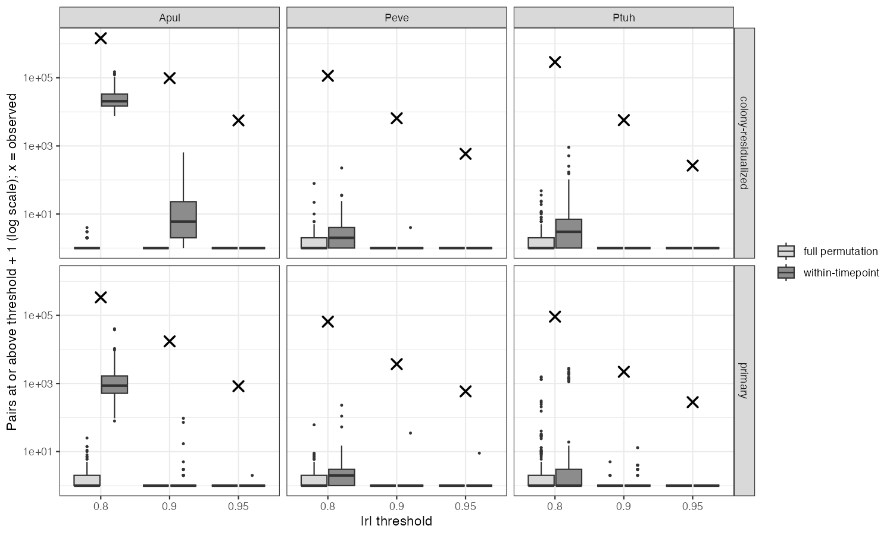
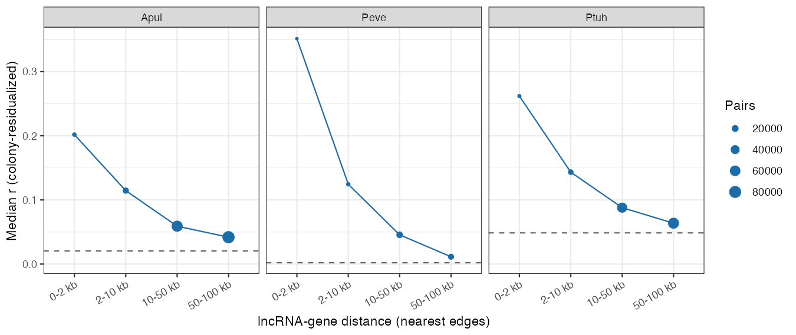
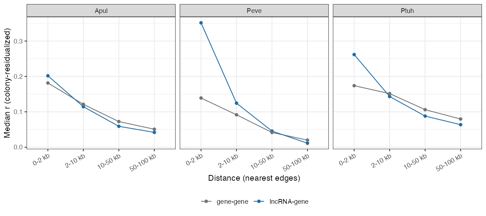
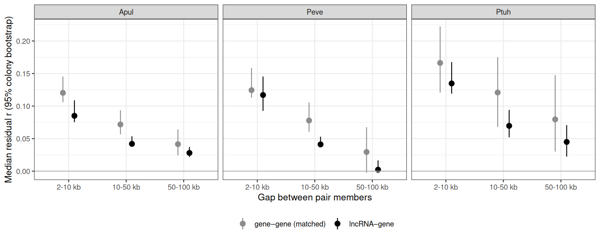

::: {.callout-warning}
## Status

This report is a Roberts Lab working manuscript. It has not been peer reviewed.

It is shared to make small scientific efforts, preliminary analyses, technical
observations, and exploratory work openly available.
:::

## Abstract

Long non-coding RNAs (lncRNAs) are often proposed to regulate neighboring
genes in cis, usually on the basis of co-expression. We tested this claim as
four pre-registered hypotheses (H08, H17, H25, H26) in the E5 MOSAiC time series: about 10
colonies each of *Acropora pulchra*, *Porites evermanni* and *Pocillopora
tuahiniensis*, sampled four times across 2020 in Mo'orea, with lncRNA and
gene expression from the same RNA-seq libraries (38–40 samples per species).
Genome-wide (H08), strong lncRNA–mRNA correlations (|r| >= 0.8) number in the
tens to hundreds of thousands per species, where label permutation produces
almost none, but they track per-sample structure shared by both layers rather
than lncRNA-specific co-regulation. Within colonies (H17), lncRNAs co-vary with protein-coding genes within 10 kb far
more than with expression-matched genes on other scaffolds (median r 0.14 to
0.19 against null medians of 0.00 to 0.05), and the coupling falls steadily
with distance in all three species. The pre-registered decision rule
returns `supported`. However, a gene–gene control shows that neighboring
protein-coding genes co-vary almost as strongly. The lncRNA-specific excess
is concentrated within 2 kb of genes, where unannotated UTRs, read-through
and antisense transcripts sit. Upstream lncRNA annotations carry no strand,
so those cannot be separated from regulation. Two follow-ups sharpened this.
A pre-registered equivalence test beyond 2 kb (H25, `inconclusive`) could not
show that lncRNA–gene and gene–gene coupling are equivalent: after matching
for distance and expression, lncRNA–gene coupling was about a third weaker
in every species (intervals excluding 0 but crossing the ±25% margin). A
held-out test (H26, `not supported`) found that distal lncRNA–gene
associations selected in nine colonies made predictions for the tenth worse,
not better, while the same pipeline with distal genes as predictors improved
them by 25–52%. Cis co-variation is real but modest (about 2–4% of
within-colony variance), most of it reflects local genomic co-expression, and
we find no evidence for distal lncRNA associations that generalize across
colonies.

## Background

lncRNA function in non-model invertebrates is usually inferred from
co-expression with nearby genes. Two problems make that inference weak.
First, with few samples, strong correlations arise by chance. A companion
pre-registered test (H08) showed that with about 40 samples per species,
strong lncRNA–mRNA correlations do exceed a permutation null (see Results),
but that genome-wide edges are dominated by per-sample library structure
shared by both layers. Second, genes that sit close together tend to be co-expressed
whatever they encode, because they share chromatin context. A cis claim
for lncRNAs therefore needs both a null that keeps library structure and a
comparison with gene–gene neighbors at the same distances.

## Methods

**Data.** Gene and lncRNA count matrices, gene coordinates and lncRNA
coordinates from the E5 MOSAiC data portal (pinned commit `86432e3`). All
samples with both layers: *A. pulchra* 40, *P. evermanni* 38,
*P. tuahiniensis* 39; 10 colonies per species, four timepoints.

**Pre-registration.** Hypotheses, models and decision rules were committed
before analysis ([H08](https://github.com/urol-e5/MOSAiC-hypotheses/blob/main/hypotheses/H08/hypothesis.md),
[H17](https://github.com/urol-e5/MOSAiC-hypotheses/blob/main/hypotheses/H17/hypothesis.md),
[H25](https://github.com/urol-e5/MOSAiC-hypotheses/blob/main/hypotheses/H25/hypothesis.md),
[H26](https://github.com/urol-e5/MOSAiC-hypotheses/blob/main/hypotheses/H26/hypothesis.md)).
One dated amendment to H17, also written before analysis, records that the
upstream lncRNA features have no strand. It drops the orientation analysis
and fixes the details of the null. H25 and H26 were proposed on 2026-10-08
because H17's gene–gene comparison raised the question, and pre-registered
on 2026-10-09; they reuse the same data, so they are follow-ups, not
replications. H26 excludes one *P. evermanni* locus on scaffold 167 that
takes a median 69% of that species' reads (MOSAiC-hypotheses decision
D-017).

**Genome-wide test (H08).** Pearson r on vst values for every lncRNA ×
mRNA pair (1.7 to 3.3 × 10^8 pairs per species), counting pairs at |r| >= 0.8,
0.9 and 0.95, against 200 permutations of lncRNA sample labels (the decision
null), a within-timepoint permutation, and a colony-residualized version.

**Cis test (H17).** Both layers were variance-stabilized (DESeq2 vst) on the same
samples and residualized on colony, so correlations reflect within-colony
co-variation across the year. For every lncRNA–gene pair on the same scaffold
within 100 kb, we computed Pearson r. The test set was non-overlapping pairs
within 10 kb (8,528 to 21,666 pairs per species). For each, 100 candidate
null partners were drawn from genes on other scaffolds in the same
mean-expression decile as the true neighbor. Each of 1000 null draws took one
partner per pair and recorded the median r. Because null partners are
measured in the same samples, per-sample library effects appear in both the
observed and null values. The effect size is dr, the observed median r minus
the mean null median. Pre-registered checks: residualizing timepoint as well,
dropping all pairs within 2 kb, and repeating the whole procedure with
gene–gene neighbor pairs.

**Distal equivalence (H25).** Pairs 2–100 kb apart (overlapping pairs and
pairs within 2 kb removed), Pearson r of vst residualized on colony and
timepoint, in bins of 2–10, 10–50 and 50–100 kb. lncRNA–gene pairs were
compared with gene–gene pairs reweighted within strata of gap, the anchor
gene's expression, and the partner's expression and residual noise. The
statistic is the bin-averaged difference in median r divided by the
bin-averaged gene–gene median. Equivalence was tested with two one-sided
tests against a ±25% margin (2,000 colony-bootstrap resamples within site,
Holm across species); a scaffold-block bootstrap assessed genomic
dependence.

**Held-out prediction (H26).** lncRNAs at least 10 kb from any annotated
gene, with at least 10 kb of assembled flank (297–1,317 per species). In
each of 10 leave-one-colony-out folds, normalization and selection used the
training colonies only: for each gene on another scaffold, its strongest
isolated lncRNA after adjusting for colony, timepoint, log library size and
the top-10-feature read fraction, keeping up to 100 targets with |r| ≥ 0.6.
Mixed models with and without the lncRNA predicted the held-out colony; the
statistic is the variance-scaled reduction in held-out error. The null
reassigned whole lncRNA colony trajectories within site (1,000 of 14,399
permutations, the full pipeline re-run each time). Benchmark: the same
pipeline with expression-matched isolated genes as predictors.

## Results

### Genome-wide co-expression exceeds chance (H08, supported)

| Species | Pairs at \|r\| >= 0.8 / 0.9 / 0.95 | Full-permutation null, 95th percentile |
|---|---|---|
| *A. pulchra* | 337,796 / 17,285 / 832 | 4 / 0 / 0 |
| *P. evermanni* | 65,442 / 3,707 / 586 | 4 / 0 / 0 |
| *P. tuahiniensis* | 91,823 / 2,203 / 282 | 32 / 0 / 0 |

Observed counts exceed every null at every threshold in every species
(@fig-h08). Shared seasonal signal produces few strong edges (within-timepoint
null medians 0 to 5 at |r| >= 0.9), and residualizing colony *raises* the
counts (*A. pulchra* 338k to 1.45M at 0.8). Strong edges therefore come from
sample-level variation below colony and season, where shared library effects
(RNA integrity, composition) would also sit. This is why the cis test below
uses a null measured in the same samples.

{#fig-h08}

### Cis co-variation with neighbors (H17, supported)

lncRNA–gene coupling within 10 kb exceeds the expression-matched null in all
three species (one-sided p = 0.001, the floor, in each).

| Species | Median r, ≤ 10 kb | Null median | dr (95% interval) |
|---|---|---|---|
| *A. pulchra* | 0.138 | 0.020 | 0.117 (0.112–0.123) |
| *P. evermanni* | 0.193 | 0.002 | 0.191 (0.184–0.199) |
| *P. tuahiniensis* | 0.176 | 0.049 | 0.127 (0.121–0.133) |

Coupling decays monotonically with distance in every species
(@fig-distance). The result holds with timepoint also residualized and with
all pairs within 2 kb removed (dr 0.09 to 0.19).

{#fig-distance}

The gene–gene control changes the interpretation (@fig-genegene). Beyond
2 kb, lncRNA–gene pairs co-vary as much as neighboring gene–gene pairs do,
and slightly less in *A. pulchra* and *P. tuahiniensis*. The lncRNA excess
over gene–gene pairs is in the 0–2 kb bin: *P. evermanni* 0.35 vs 0.14,
*P. tuahiniensis* 0.26 vs 0.17, *A. pulchra* 0.20 vs 0.18. Over the whole
≤ 10 kb set, lncRNA dr minus gene–gene dr is 0.009 (*A. pulchra*), 0.092
(*P. evermanni*) and 0.038 (*P. tuahiniensis*).

{#fig-genegene}

Pairs where the lncRNA overlaps the gene were excluded from the test. As
expected from shared reads, they correlate strongly (median r 0.54 to 0.71).

### Beyond 2 kb, equivalence is not established (H25, inconclusive)

After matching, lncRNA–gene pairs co-vary less than gene–gene pairs in every
species and distance bin (@fig-h25). The relative difference is −0.34
(*A. pulchra*, 95% interval −0.48 to −0.13), −0.31 (*P. evermanni*, −0.47 to
−0.10) and −0.32 (*P. tuahiniensis*, −0.42 to −0.05). No species establishes
equivalence within ±25%, and no interval lies wholly beyond the margin, so
the pre-registered verdict is `inconclusive`. Every interval excludes 0, in
both colony and scaffold-block resampling, and the gap shrinks only slightly
(by 0.05–0.07) when timepoint is left in. The descriptive comparison above,
which did not match on expression, overstated how similar the two classes
are beyond 2 kb.

{#fig-h25}

### Distal lncRNA associations do not generalize to new colonies (H26, not supported)

Every fold found 100 targets with |r| ≥ 0.6 to an isolated lncRNA (median
selected |r| about 0.93), but adding that lncRNA made predictions for the
held-out colony worse (@fig-h26): improvement −0.21 (*A. pulchra*, 95%
interval −0.71 to 0.30), −0.55 (*P. evermanni*, −0.91 to −0.18) and −0.40
(*P. tuahiniensis*, −0.79 to −0.14). The pre-registered verdict is `not
supported`: the upper bound is below the 5% threshold in two species. In
*A. pulchra* the selected pairs still did better than every permutation
(p = 0.001), so they carry some reproducible association, but not enough to
help prediction. Selection concentrated on a few lncRNAs (two supply 68% of
*A. pulchra*'s pairs). With expression-matched isolated genes as predictors,
the same pipeline improved held-out prediction by 0.52, 0.25 and 0.39, all
with intervals above 0.

{#fig-h26}

## Discussion

The genome-wide result (H08) answers a methods question: with about 40
samples, strong correlations are not a small-sample artifact, unlike the
n = 5 setting in which a published 0.99 cut sat near the null. It does not
identify co-regulation. The data support cis co-variation between lncRNAs and nearby genes. They do
not, by themselves, support cis regulation by lncRNAs. Most of the signal is
what any two neighboring genes show, consistent with shared local chromatin
or transcriptional neighborhoods. What remains specific to lncRNAs is
concentrated within 2 kb of genes. That is the zone where an annotated
"lncRNA" may be an unannotated UTR, a read-through transcript, or an antisense
transcript. Each predicts near-gene correlation, but only the last is a
plausible regulatory lncRNA. The near-gene excess is largest in
*P. evermanni*, whose assembly is the most fragmented (N50 0.17 Mb) and whose
gene models are likely the least complete, which fits an annotation
explanation. Strand information would separate these cases, and we have
asked upstream whether stranded coordinates exist
([urol-e5/timeseries_molecular#139](https://github.com/urol-e5/timeseries_molecular/issues/139)).

The follow-ups narrow what remains. Beyond 2 kb, lncRNAs are not more
co-expressed with their neighbors than genes are; matched for expression
they are about a third less so (H25), although the data cannot show whether
that shortfall exceeds a quarter of the gene–gene signal. And the many strong
distal lncRNA–mRNA correlations do not carry over to colonies not used to
find them (H26), while distal gene–gene associations selected the same way
do. Distal lncRNA edges in these data look like a few lncRNAs tracking broad
expression axes, or shared library structure, rather than specific
regulatory links. A less aggressive selection (fewer, stronger edges, or
shrinkage) could behave differently and would be a new test.

Limitations: about 10 colonies per species (H26 tests each fold on 2–4 samples); pairs are not independent (one
lncRNA can neighbor several genes); *P. tuahiniensis* reads are mapped to
the *P. meandrina* reference; correlation cannot establish function, which
needs perturbation. A practical recommendation for lncRNA studies in corals
and other invertebrates is to report gene–gene neighbor co-expression at
matched distances alongside any lncRNA cis claim.

## Data and code availability

- Hypothesis, analysis and full results: [urol-e5/MOSAiC-hypotheses, H17](https://github.com/urol-e5/MOSAiC-hypotheses/tree/main/hypotheses/H17)
  (`hypothesis.md`, `analysis.qmd`, `RESULT.md`, `output/`)
- Genome-wide test: [urol-e5/MOSAiC-hypotheses, H08](https://github.com/urol-e5/MOSAiC-hypotheses/tree/main/hypotheses/H08)
- Distal equivalence: [urol-e5/MOSAiC-hypotheses, H25](https://github.com/urol-e5/MOSAiC-hypotheses/tree/main/hypotheses/H25)
- Held-out prediction: [urol-e5/MOSAiC-hypotheses, H26](https://github.com/urol-e5/MOSAiC-hypotheses/tree/main/hypotheses/H26)
- Data portal: [urol-e5/MOSAiC](https://github.com/urol-e5/MOSAiC), commit `86432e3e393aecca307be356e514c95981177b7c`

## Suggested citation

Roberts, S. B. 2026. *lncRNAs Co-vary with Neighboring Genes in Three Reef Corals, Mostly as Local Co-expression*. Current Findings. Available at: https://robertslab.github.io/current-findings/reports/coral-lncrna-cis-coexpression/

## Version history

| Version | Date | Notes |
|---|---|---|
| 0.1 | 2026-10-07 | Initial draft from MOSAiC-hypotheses H17 |
| 0.2 | 2026-10-08 | Added the genome-wide test (H08) |
| 0.3 | 2026-10-10 | Added distal equivalence (H25) and held-out prediction (H26); revised the beyond-2-kb statement |
