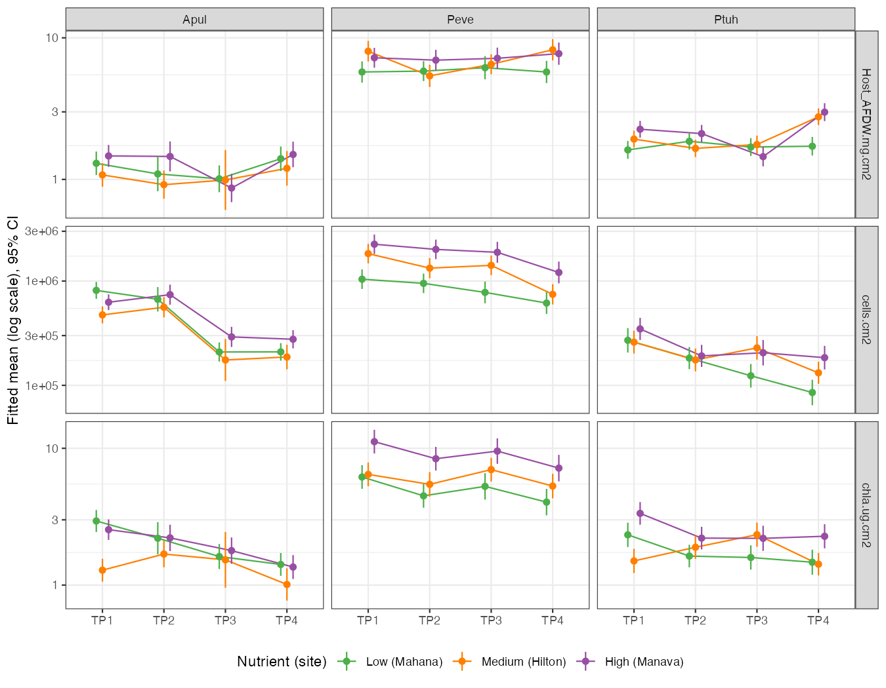

::: {.callout-warning}
## Status

This report is a Roberts Lab working manuscript. It has not been peer reviewed.

It is shared to make small scientific efforts, preliminary analyses, technical
observations, and exploratory work openly available.
:::

## Abstract

Does nutrient enrichment change how reef corals move through the seasons? We
tested this as a pre-registered hypothesis (H12) in the E5 MOSAiC physiology
data. These cover 45–50 colonies each of *Acropora pulchra*, *Porites
evermanni* and *Pocillopora tuahiniensis*, at three Mo'orea sites with low,
medium and high nutrient levels, sampled across 2020. We modeled symbiont
density, chlorophyll *a* and host biomass (ash-free dry weight, AFDW) with a
timepoint × nutrient interaction and colony as a random effect. The
pre-registered rule returns `inconclusive`. *P. tuahiniensis* shows the
interaction in all three traits (FDR ≤ 0.006). *A. pulchra* shows it in two
traits at FDR 0.057, just short of the 0.05 threshold. *P. evermanni* shows
none: its high-nutrient colonies hold more symbionts and chlorophyll all year,
but their seasonal trajectories run parallel to those at the low site. The
largest single effect is in *P. tuahiniensis* biomass. From January to
September it falls to 0.61 times the change seen at the low-nutrient site
(95% CI 0.47–0.80), then recovers by November. Site and nutrient level are
perfectly confounded, so these are site effects that may or may not be caused
by nutrients.

## Background

Nutrient enrichment is expected to raise symbiont density and alter host
energetics, but whether it changes the *seasonal trajectory* of physiology,
rather than just its level, is less clear. The MOSAiC time series samples the
same colonies four times in 2020 (January, March, September, November) at
three sites with different nutrient regimes. That allows a direct test of a
timepoint × nutrient interaction with colony as a repeated unit. The
physiology layer covers far more colonies than the molecular layers (about
10 colonies per species at two sites), so this is one of the better-powered
tests in the project.

## Methods

**Data.** The physiology layer of the E5 MOSAiC data portal (pinned commit
`86432e3`): symbiont cells per cm², chlorophyll *a* per cm² and host AFDW per
cm², from 115–167 colony × timepoint samples per species. Colonies were
sampled at 2–4 of the four timepoints.

**Design.** Every species × site cell had 15–19 colonies, far above the
pre-registered minimum of three:

| Species | Hilton (medium) | Mahana (low) | Manava (high) |
|---|---|---|---|
| *A. pulchra* | 15 | 19 | 16 |
| *P. evermanni* | 15 | 16 | 15 |
| *P. tuahiniensis* | 15 | 15 | 15 |

**Pre-registration.** The model and decision rule were committed before
analysis and applied without amendment
([H12 hypothesis.md](https://github.com/urol-e5/MOSAiC-hypotheses/blob/main/hypotheses/H12/hypothesis.md)).
For each species and trait, the model was
`lmer(log(trait) ~ timepoint * nutrient + (1|colony))`. The interaction was
tested with a likelihood-ratio test (6 df), with Benjamini–Hochberg
correction across the three traits within species. The rule: `supported` if
two of three traits reach FDR < 0.05 in at least two species; `not supported`
if no interaction reaches FDR < 0.2 in any species; otherwise `inconclusive`.
As an effect size we report the ratio of the January→September fold change at
the high-nutrient site to that at the low-nutrient site, with a Wald 95% CI.

## Results

| Species | Trait | χ² (6 df) | FDR | Jan→Sep change, high vs low (95% CI) |
|---|---|---|---|---|
| *A. pulchra* | symbiont density | 14.6 | 0.057 | 1.81 (1.25–2.64) |
| *A. pulchra* | chlorophyll *a* | 13.4 | 0.057 | 1.28 (0.87–1.88) |
| *A. pulchra* | host AFDW | 5.5 | 0.48 | 0.76 (0.51–1.15) |
| *P. evermanni* | symbiont density | 5.8 | 0.67 | 1.12 (0.74–1.69) |
| *P. evermanni* | chlorophyll *a* | 2.6 | 0.86 | 1.00 (0.66–1.52) |
| *P. evermanni* | host AFDW | 10.4 | 0.33 | 0.93 (0.65–1.31) |
| *P. tuahiniensis* | symbiont density | 18.3 | 0.0054 | 1.29 (0.81–2.06) |
| *P. tuahiniensis* | chlorophyll *a* | 27.2 | 0.0002 | 0.96 (0.66–1.40) |
| *P. tuahiniensis* | host AFDW | 37.6 | 4 × 10⁻⁶ | 0.61 (0.47–0.80) |

The pre-registered verdict is `inconclusive`: one species (*P. tuahiniensis*)
meets the two-trait criterion, and *A. pulchra* has interactions at
FDR < 0.2.

{#fig-traj}

The trajectories (@fig-traj) show three different patterns:

- **Porites: a level effect only.** High-nutrient *P. evermanni* colonies
  have more symbionts and chlorophyll at every timepoint, but all three sites
  change in parallel through the year.
- **Pocillopora: trajectories diverge.** High-nutrient *P. tuahiniensis*
  colonies lose biomass from January to September and recover by November,
  while low-nutrient colonies stay flat. Symbiont density declines steadily
  at the low-nutrient site but stays nearly flat after March at the
  high-nutrient site.
- **Acropora: partly site idiosyncrasy.** Symbiont density in *A. pulchra*
  falls less from January to September at the high-nutrient site (ratio
  1.81). Part of the interaction comes from the medium-nutrient site,
  however: its January chlorophyll falls below both other sites, which does
  not fit a simple nutrient gradient.

Restricted to the two sites that also carry the molecular data (low vs
high), the same pattern holds: *P. tuahiniensis* AFDW (FDR 8 × 10⁻⁶) and
symbiont density (0.024), and *A. pulchra* symbiont density (0.002). This
check was descriptive and not part of the pre-registered rule.

## Discussion

The three genera respond to the same site contrast in different ways.
*Porites* differs only in level: more symbionts where nutrients are higher,
with an unchanged seasonal course. That fits its reputation as a
physiologically conservative, stress-tolerant genus. *Pocillopora* changes
its seasonal course, most clearly in host biomass, which dips through the
cool season at the high-nutrient site and recovers. *Acropora* is
intermediate, and its signal is partly driven by a site that is out of
nutrient order. This mirrors the companion finding that *Acropora* is by far
the most transcriptionally plastic of the three across the year
([seasonal transcriptome report](../coral-seasonal-transcriptome-plasticity/)),
but the physiology ranking here is *Pocillopora* > *Acropora* > *Porites*.
Plasticity in gene expression and in physiology need not align.

The main limitation is that nutrient level is a site attribute. Each site has
one nutrient level, so any other site difference (depth, flow, light,
microhabitat, colony history) is indistinguishable from nutrient enrichment.
The medium-nutrient site does not always fall between the other two, which
argues for at least some site idiosyncrasy. Other limitations: colonies were
sampled at 2–4 timepoints rather than all four, and *Acropora* sampling is
uneven across the year (42 / 24 / 21 / 29 samples). The interaction test is
joint over six degrees of freedom; the January→September ratio summarizes
only one contrast of it. Separating nutrients from site would need replicate
sites within each nutrient level or an enrichment experiment.

## Data and code availability

- Hypothesis, analysis and full results: [urol-e5/MOSAiC-hypotheses, H12](https://github.com/urol-e5/MOSAiC-hypotheses/tree/main/hypotheses/H12)
  (`hypothesis.md`, `analysis.qmd`, `RESULT.md`, `output/`)
- Data portal: [urol-e5/MOSAiC](https://github.com/urol-e5/MOSAiC), commit `86432e3e393aecca307be356e514c95981177b7c`

## Suggested citation

Roberts, S. B. 2026. *Site Nutrient Context Shifts the Seasonal Physiology of Pocillopora, Less So Acropora, and Not Porites*. Current Findings. Available at: https://robertslab.github.io/current-findings/reports/coral-nutrient-site-seasonal-physiology/

## Version history

| Version | Date | Notes |
|---|---|---|
| 0.1 | 2026-10-08 | Initial draft from MOSAiC-hypotheses H12 |
