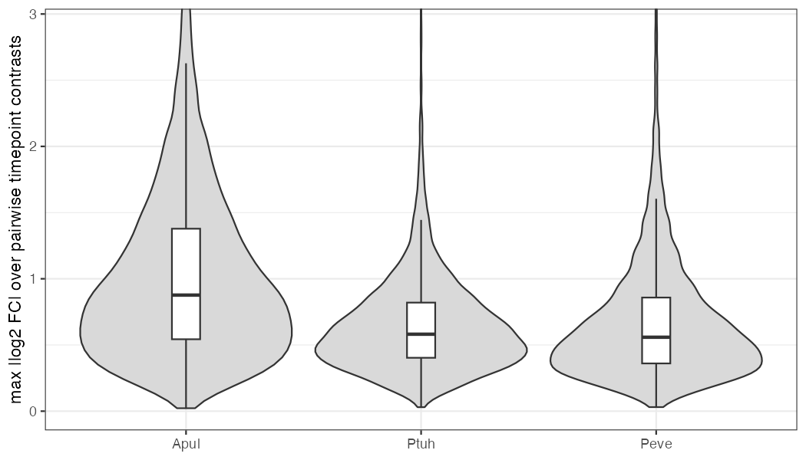
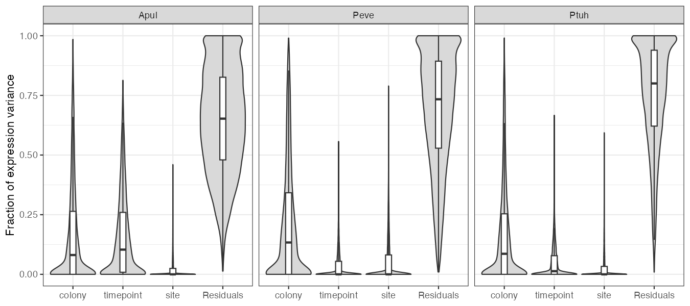
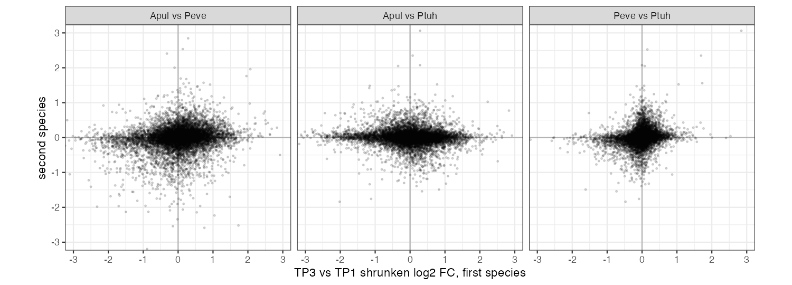

::: {.callout-warning}
## Status

This report is a Roberts Lab working manuscript. It has not been peer reviewed.

It is shared to make small scientific efforts, preliminary analyses, technical
observations, and exploratory work openly available.
:::

## Abstract

Do reef corals differ in how much their gene expression changes across the
year, and is the change they show a shared program? We tested three
pre-registered hypotheses in the E5 MOSAiC time series: 10 colonies each of
*Acropora pulchra*, *Porites evermanni* and *Pocillopora tuahiniensis*,
sampled in January, March, September and November 2020 in Mo'orea (38–40
RNA-seq samples per species). On 9,017 three-way ortholog groups, H02
(`supported`) found 5,007 groups (55.5%) changing across timepoints in
*A. pulchra*, against 505 (5.8%) in *P. tuahiniensis* and 414 (6.0%) in
*P. evermanni*, with a median maximum |log2 fold change| of 0.88 against
0.58 and 0.56. The pre-registered rule tested a three-way ranking, but only
the *Acropora* gap is large; *Pocillopora* and *Porites* are close. H01
(`not supported`) found that colony identity outweighs season in
*P. evermanni* and *P. tuahiniensis* but not in *A. pulchra*, where season
explains slightly more variance than colony. H03 (`not supported`) found
that summer-to-winter changes at orthologs are weakly or negatively
correlated between species (Spearman rho −0.08 to 0.23) with no shared
enriched functions. Seasonal transcriptome plasticity in this system is
species-specific: large in *Acropora*, small in the other two, and not a
common cnidarian program. Each species has about 10 colonies, and species
is confounded with reference-genome quality.

## Background

Corals with different life histories are expected to respond differently to
environmental change. Fast-growing, competitive taxa such as *Acropora* are
often more stress-sensitive than massive, stress-tolerant *Porites*, with
*Pocillopora* in between. If transcriptional plasticity follows the same
axis, seasonal change in gene expression should rank *Acropora* >
*Pocillopora* > *Porites*. Two further questions frame this. First, how
large is seasonal change relative to the stable differences among colonies
(H01)? Second, when species do respond, do orthologous genes move in the same
direction, as a shared seasonal program would predict (H03)? Gene sets differ
in size and annotation across species, so comparisons use three-way
orthologs.

## Methods

**Data.** Gene count matrices and three-way ortholog tables from the E5
MOSAiC data portal (pinned commit `86432e3`). Samples: *A. pulchra* 40
(10 colonies × 4 timepoints), *P. evermanni* 38 (one colony missing TP3 and
TP4), *P. tuahiniensis* 39 (one colony missing TP4); 5 colonies at each of
two sites. Genes were kept with >= 10 counts in >= 25% of samples.

**Pre-registration.** Questions, models and decision rules were committed
before analysis ([H01](https://github.com/urol-e5/MOSAiC-hypotheses/blob/main/hypotheses/H01/hypothesis.md),
[H02](https://github.com/urol-e5/MOSAiC-hypotheses/blob/main/hypotheses/H02/hypothesis.md),
[H03](https://github.com/urol-e5/MOSAiC-hypotheses/blob/main/hypotheses/H03/hypothesis.md)).
None of the three was amended.

**Variance partition (H01).** Per gene and species, `variancePartition` with
`~ (1|colony) + (1|timepoint) + (1|site)` on DESeq2 vst counts (all
filtered genes, 20,796–21,108 per species). The rule compared median colony
and timepoint fractions using 95% bootstrap intervals over genes. Checks:
site dropped; three-way orthologs only.

**Seasonal plasticity (H02).** On the 9,017 ortholog groups common to all
three species after filtering, DESeq2 per species with a likelihood-ratio
test of `~ colony + timepoint` against `~ colony` (BH FDR 0.05). For each
group, the maximum |log2 FC| over the six pairwise timepoint contrasts;
species compared by Kruskal–Wallis and pairwise Wilcoxon (Hodges–Lehmann
shift, Holm correction). The rule required both the DE count and the median
max |LFC| to rank *A. pulchra* > *P. tuahiniensis* > *P. evermanni*, with
significant adjacent tests. Checks: ortholog groups with average identity
>= 60%; groups with a SwissProt name; reads downsampled to the lowest
species median depth (8.75 M).

**Conserved response (H03).** TP3 (September) vs TP1 (January) contrasts
from the H02 fits, with apeglm-shrunken log2 FC. Spearman rho for each
species pair, tested against 1000 permutations of ortholog assignment, and
GO-slim enrichment (Fisher, BH) among groups concordantly DE in both species
of a pair. The rule required rho > 0.2 (permutation p < 0.01) in all pairs
and at least three GO-slim terms enriched in all three concordant sets.
Check: average identity >= 60%.

## Results

### Acropora is far more seasonally plastic (H02, supported)

| Species | Groups tested | DE across timepoints | Proportion DE (95% CI) | Median max \|LFC\| |
|---|---|---|---|---|
| *A. pulchra* | 9,017 | 5,007 | 0.555 (0.545–0.566) | 0.877 |
| *P. tuahiniensis* | 8,667 | 505 | 0.058 (0.053–0.063) | 0.581 |
| *P. evermanni* | 6,919 | 414 | 0.060 (0.054–0.066) | 0.559 |

Both orderings follow *A. pulchra* > *P. tuahiniensis* > *P. evermanni*, and
both adjacent Wilcoxon tests are significant (Kruskal–Wallis chi-squared =
2314.9, df = 2), so the pre-registered rule returns `supported`. The two
steps are very different in size (@fig-h02). The max-|LFC| shift is 0.280
log2 units (95% CI 0.267–0.294) for *A. pulchra* over *P. tuahiniensis*,
but 0.014 (0.004–0.023; Holm p = 0.004) for *P. tuahiniensis* over
*P. evermanni*. All three pre-registered checks also return `supported`,
and the *Acropora* gap is stable across them: DE counts 4,151 / 401 / 285
(identity >= 60%), 2,058 / 194 / 141 (SwissProt name), and 4,999 / 501 / 402
(downsampled).

{#fig-h02}

### Season outweighs colony only in Acropora (H01, not supported)

Median fraction of expression variance across genes (95% bootstrap CI over
genes):

| Species | Colony | Timepoint | Residual |
|---|---|---|---|
| *A. pulchra* | 0.081 (0.077–0.084) | 0.104 (0.101–0.107) | 0.65 |
| *P. evermanni* | 0.133 (0.130–0.138) | 0.00003 (0–0.001) | 0.73 |
| *P. tuahiniensis* | 0.086 (0.083–0.089) | 0.013 (0.012–0.015) | 0.80 |

The rule returns `not supported` because timepoint exceeds colony in
*A. pulchra* (@fig-h01). Colony dominates in the other two species. The
*A. pulchra* ordering depends on how site is modeled: with site dropped,
colony edges ahead (0.112 vs 0.100) and that check returns `supported`. On
three-way orthologs only, the *A. pulchra* gap widens (timepoint 0.156 vs
colony 0.025), and that check returns `not supported`.

{#fig-h01}

### Seasonal responses are not shared across species (H03, not supported)

| Pair | Spearman rho (95% CI) | Permutation p | Concordant DE groups | Enriched GO-slim terms |
|---|---|---|---|---|
| *A. pulchra*–*P. evermanni* | 0.180 (0.160–0.198) | 0.001 | 91 | 0 |
| *A. pulchra*–*P. tuahiniensis* | −0.075 (−0.095 to −0.056) | 1.0 | 21 | 0 |
| *P. evermanni*–*P. tuahiniensis* | 0.235 (0.215–0.254) | 0.001 | 7 | 0 |

Only the *Porites*–*Pocillopora* pair passes the rho threshold, the
*Acropora*–*Pocillopora* correlation is negative, and no GO-slim term is
enriched in any pair (@fig-h03). The rule returns `not supported` on both
conditions independently. The identity >= 60% check gives the same picture
(rho 0.176 / −0.077 / 0.238; `not supported`). TP3-vs-TP1 DE counts were
3,457 (*A. pulchra*), 791 (*P. evermanni*) and 224 (*P. tuahiniensis*).

{#fig-h03}

## Discussion

The three results agree on one point: seasonal transcriptome plasticity is
species-specific. *Acropora pulchra* changes expression in over half of its
conserved genes across the year, and in this species season accounts for
roughly as much variance as colony identity. In *Porites evermanni* and
*Pocillopora tuahiniensis*, about 6% of groups change and colony dominates.
The *Acropora* response is not a stronger version of a program the other
species share. It correlates weakly with *Porites* and runs slightly opposite
to *Pocillopora*.

The pre-registered H02 rule tested a full three-way ranking and returned
`supported`, but the data justify less. The *Pocillopora* > *Porites* step is
a shift of about 1% in fold change, significant mainly because about 9,000
non-independent groups enter the test. The DE counts for these two species
also reflect DESeq2 independent filtering (6,919 vs 8,667 groups tested). As
a proportion of groups tested, the two are indistinguishable in the primary
analysis, although *P. tuahiniensis* exceeds *P. evermanni* in the
annotation subsets where both are tested on the same groups (5.5% vs 3.9% at
identity >= 60%). The defensible claim is "*Acropora* is far more seasonally
plastic than *Pocillopora* or *Porites*", which fits the life-history
expectation for *Acropora* but does not resolve the other two.

Similarly, the H01 verdict rests on *A. pulchra*, where the colony-vs-season
ordering is close and flips when the two-level site term is dropped. The
ortholog-only check suggests the *Acropora* seasonal signal sits in
conserved genes and is not an artifact of reference quality. In H03, the
negative *Acropora*–*Pocillopora* correlation is robust to ortholog
identity, but the missing GO-slim enrichment is largely a power problem
(concordant sets of 7 to 91 groups; about 40% of groups carry GO-slim
annotation). The *Porites*–*Pocillopora* correlation, the strongest, comes
from many small shifts in the species with the fewest DE genes. A shared
non-biological factor such as collection day or sequencing batch could
produce it as easily as shared biology.

Limitations: about 10 colonies per species. Bootstrap intervals in H01
resample genes, not colonies, and H02/H03 p-values treat non-independent
groups as independent, so all intervals and p-values are optimistic.
Species is confounded with reference-genome quality (*P. evermanni* N50
0.17 Mb; *P. tuahiniensis* reads mapped to *P. meandrina*). *P. evermanni*'s
near-zero timepoint share may partly reflect its two missing late-year
samples. Species-specific sequencing batches across timepoints cannot be
separated from season. Timepoints differ in temperature, light, nutrients and
reproductive timing, so none of these responses can be attributed to
temperature.

## Data and code availability

- Seasonal plasticity: [urol-e5/MOSAiC-hypotheses, H02](https://github.com/urol-e5/MOSAiC-hypotheses/tree/main/hypotheses/H02)
  (`hypothesis.md`, `analysis.qmd`, `RESULT.md`, `output/`)
- Variance partition: [urol-e5/MOSAiC-hypotheses, H01](https://github.com/urol-e5/MOSAiC-hypotheses/tree/main/hypotheses/H01)
- Conserved seasonal response: [urol-e5/MOSAiC-hypotheses, H03](https://github.com/urol-e5/MOSAiC-hypotheses/tree/main/hypotheses/H03)
- Data portal: [urol-e5/MOSAiC](https://github.com/urol-e5/MOSAiC), commit `86432e3e393aecca307be356e514c95981177b7c`

## Suggested citation

Roberts, S. B. 2026. *Seasonal Transcriptome Change Is Large in Acropora and Small, and Not Shared, in Porites and Pocillopora*. Current Findings. Available at: https://robertslab.github.io/current-findings/reports/coral-seasonal-transcriptome-plasticity/

## Version history

| Version | Date | Notes |
|---|---|---|
| 0.1 | 2026-10-07 | Initial draft from MOSAiC-hypotheses H01, H02, H03 |
