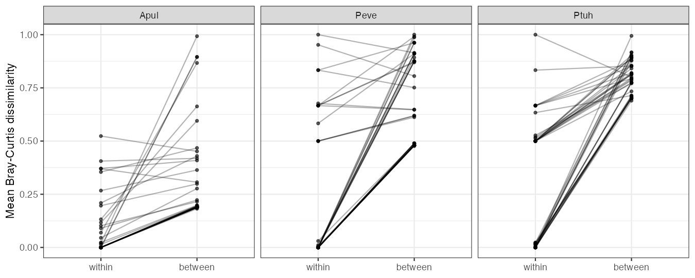

::: {.callout-warning}
## Status

This report is a Roberts Lab working manuscript. It has not been peer reviewed.

It is shared to make small scientific efforts, preliminary analyses, technical
observations, and exploratory work openly available.
:::

## Abstract

Reef corals can in principle shuffle their Symbiodiniaceae communities as
conditions change through the year. We tested, as a pre-registered hypothesis
(H10), whether symbiont composition in the E5 MOSAiC time series is instead a
fixed colony trait. Colonies of *Acropora pulchra*, *Porites evermanni* and
*Pocillopora tuahiniensis* in Mo'orea were sampled in January, March,
September and November 2020, and ITS2 type profiles were obtained for 120 to
162 samples per species. Colony identity explains most of the variation in
community composition (PERMANOVA R2 0.885, 0.797 and 0.726), whereas
timepoint explains less than 1% (R2 0.003 to 0.009, permutation p 0.26 to
0.68). A colony's samples taken at different times are much more similar to
each other than to other colonies sampled at the same time (p < 1e-7 in each
species). The pre-registered decision rule returns `supported`. The
prediction that *Durusdinium*-hosting colonies differ in physiology could not
be tested as written, because *P. evermanni* and *P. tuahiniensis* are
entirely *Cladocopium*-dominated. In *A. pulchra*, *Durusdinium*- and
*Symbiodinium*-dominated samples showed no detectable difference in symbiont
density or calcification.

## Background

Whether coral–symbiont associations are flexible over seasonal timescales
matters for how corals respond to warming: shuffling toward more
thermotolerant symbionts is one proposed acclimatization route. It also
matters for multi-omic time series. If symbiont communities shift across
timepoints, they are a time-varying covariate for host molecular data; if
they are fixed, they are a colony-level property. The MOSAiC design, with
repeated sampling of the same colonies across a year, separates colony and
season effects on symbiont composition directly.

## Methods

**Data.** SymPortal ITS2 type-profile relative abundances and colony
physiology from the E5 MOSAiC data portal (pinned commit `86432e3`). All
ITS2 samples were used. ITS2 covers more colonies than the molecular layers:
*A. pulchra* 120 samples from 50 colonies (7 profiles), *P. evermanni* 162
samples from 45 colonies (23 profiles), *P. tuahiniensis* 159 samples from
45 colonies (15 profiles). About 10 colonies per species are the molecular
colonies used in other MOSAiC analyses. Samples per timepoint (TP1–TP4) were
42/23/21/34 (*A. pulchra*), 44/42/40/36 (*P. evermanni*) and 40/42/39/38
(*P. tuahiniensis*).

**Pre-registration.** The hypothesis, model and decision rule were committed
before analysis ([H10 hypothesis.md](https://github.com/urol-e5/MOSAiC-hypotheses/blob/main/hypotheses/H10/hypothesis.md)).
The rule: `supported` if R2(colony) > 0.5 and R2(timepoint) < 0.1 in all
three species and within-colony distance is lower than between-colony
distance at p < 0.01; `not supported` if R2(timepoint) ≥ R2(colony) in any
species; otherwise `inconclusive`. The secondary physiology test is reported
but does not affect the status. No amendments were made.

**Analysis.** Per species, Bray-Curtis dissimilarities were partitioned with
sequential PERMANOVA (`vegan::adonis2`, `bray ~ colony + timepoint`, 999
permutations). The colony p-value used unrestricted permutations; the
timepoint p-value used permutations blocked within colony, treating timepoint
as a repeated measure. 95% intervals for R2 came from 500 bootstrap
resamples of colonies. For each colony with at least two samples, we
computed the mean dissimilarity among its own samples at different
timepoints (within) and the mean dissimilarity from its samples to other
colonies' samples at the same timepoint (between). Within and between were
compared across colonies with a one-sided paired Wilcoxon signed-rank test,
with a Hodges-Lehmann shift and 95% interval. For the secondary test, each
sample's dominant genus was taken from its most abundant profile, and
`lmer(trait ~ dominant_genus + timepoint + (1|colony))` was fit for symbiont
cell density (`cells.cm2`) and calcification (`calc.umol.cm2.hr`) where at
least two genera each dominated five or more samples.

## Results

Colony identity dominates symbiont composition in all three species, and
timepoint explains almost nothing (@tbl-main).

| Species | R2 colony (95% CI) | R2 timepoint (95% CI), p | Within / between, median | Shift (95% CI) | p |
|---|---|---|---|---|---|
| *A. pulchra* | 0.885 (0.754–0.962) | 0.003 (0.001–0.024), 0.68 | 0 / 0.195 | −0.189 (−0.207 to −0.161) | 6.7e-8 |
| *P. evermanni* | 0.797 (0.690–0.882) | 0.006 (0.004–0.022), 0.30 | 0 / 0.619 | −0.480 (−0.596 to −0.402) | 9.2e-9 |
| *P. tuahiniensis* | 0.726 (0.645–0.801) | 0.009 (0.006–0.031), 0.26 | 0.5 / 0.798 | −0.504 (−0.588 to −0.398) | 1.3e-8 |

: PERMANOVA R2 for colony and timepoint, and the paired within- vs between-colony Bray-Curtis comparison (38, 45 and 42 colonies with repeat samples). Colony permutation p = 0.001 in each species. {#tbl-main}

In *A. pulchra* and *P. evermanni* the median colony kept an identical
profile composition across the year (median within-colony distance 0).
*P. tuahiniensis* was the least fixed: its median within-colony distance of
0.5 indicates that about half its colonies changed dominant profile across
the year, but these changes were still far smaller than differences between
colonies (@fig-within-between). All three species meet every component of
the decision rule.

{#fig-within-between}

**Secondary test.** Only *A. pulchra* had more than one dominant genus:
*Durusdinium* (102 samples) and *Symbiodinium* (18). *P. evermanni* and
*P. tuahiniensis* were entirely *Cladocopium*-dominated, so the
pre-registered *Durusdinium* vs *Cladocopium* contrast was not possible. In
*A. pulchra*, *Durusdinium*-dominated samples did not differ detectably from
*Symbiodinium*-dominated samples in symbiont density (+51,756 cells cm⁻²,
95% CI −63,385 to 166,898, p = 0.38) or calcification (−0.052 µmol cm⁻² h⁻¹,
95% CI −0.115 to 0.012, p = 0.11).

## Discussion

Across four sampling times spanning a year, symbiont communities in these
three corals behaved as a colony trait rather than a seasonal variable. For
the MOSAiC time series, this suggests symbiont identity can be treated as a
fixed colony covariate in host molecular analyses, and that profile-level
symbiont shuffling is an unlikely explanation for seasonal host signals.

The strength of the test differs by species. *A. pulchra* is close to the
trivial case the pre-registration flagged: 85% of its samples carry one
profile (D1-D1u-D1jb), so its colony R2 mostly reflects which colonies host
*Symbiodinium*. *P. evermanni* (23 profiles) and *P. tuahiniensis* (15
profiles) are the more informative tests, and both still show strong colony
fidelity. The 0.5 R2 threshold is also less stringent than it reads: with 45
to 50 colony levels, the null expectation for colony R2 is roughly 0.41
(*A. pulchra*), 0.27 (*P. evermanni*) and 0.28 (*P. tuahiniensis*). The
unrestricted permutation test (p = 0.001) and the paired distance test, which
does not share this inflation, both place colony far above that baseline.

Limitations: only about 10 of the 45 to 50 colonies per species are the
molecular colonies analysed elsewhere in MOSAiC, where n is about 10
colonies per species. Coverage is uneven (*A. pulchra* TP2 and TP3 have about
half the samples of TP1), and colonies sampled once enter PERMANOVA but not
the paired test. SymPortal profiles can hide shifts in ITS2 sequence
abundance within a profile, and relative abundances are compositional. The
colony bootstrap ignores site. The secondary test covered one species and a
genus contrast other than the one predicted, one of its models gave a
near-singular fit warning, and it should be read as descriptive.

## Data and code availability

- Hypothesis, analysis and full results: [urol-e5/MOSAiC-hypotheses, H10](https://github.com/urol-e5/MOSAiC-hypotheses/tree/main/hypotheses/H10)
  (`hypothesis.md`, `analysis.qmd`, `RESULT.md`, `output/`)
- Data portal: [urol-e5/MOSAiC](https://github.com/urol-e5/MOSAiC), commit `86432e3e393aecca307be356e514c95981177b7c`

## Suggested citation

Roberts, S. B. 2026. *Symbiont Communities in Three Reef Corals Are Fixed by Colony, Not Season*. Current Findings. Available at: https://robertslab.github.io/current-findings/reports/coral-symbiont-communities-colony-fixed/

## Version history

| Version | Date | Notes |
|---|---|---|
| 0.1 | 2026-10-07 | Initial draft from MOSAiC-hypotheses H10 |
