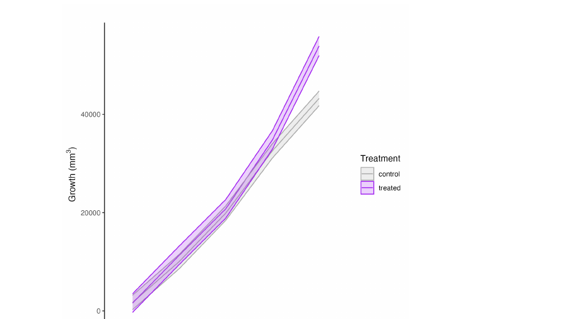
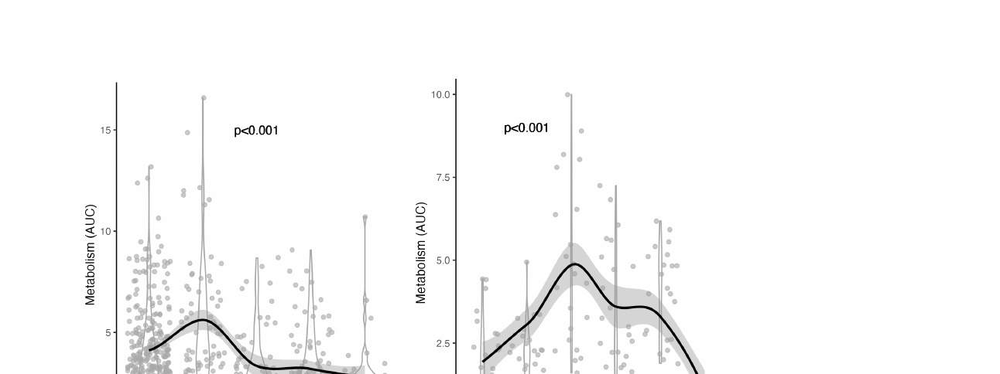

::: {.callout-warning}
## Status

This report is a Roberts Lab working manuscript. It has not been peer reviewed.

It is shared to make small scientific efforts, preliminary analyses, technical observations, and exploratory work openly available.
:::

This is a research progress report for USDA Award No. 2022-70007-38284, *Improved climate resilience in oysters through optimization of hatchery-based environmental conditioning practices.*

## Summary

Across multiple years and partnerships with shellfish farms throughout Washington State, we conducted extensive field deployments to evaluate the effects of environmental hardening on oyster performance. These efforts included temperature, salinity, combined stress, and immune priming (Poly I:C) hardening applied to seed, spat, and larval life stages, followed by long-term deployments ranging from 4 to 18 months (@tbl-summary). Temperature hardening represented the majority of trials, with repeated exposure regimes ranging from +10–20°C (above ambient conditions) applied daily or weekly over 2–3 month periods. Across six deployments testing temperature hardening, field growth was most commonly reduced (four deployments), and survival was either neutral or reduced, indicating that temperature hardening alone did not consistently improve long-term field performance. However, one experiment revealed that thermal hardening increased survival during an acute laboratory stress test after 18 months of deployment. Further, one trial demonstrated measurable physiological shifts in the expression of heat shock proteins under stress, suggesting that cellular-level resilience may emerge even in the absence of field-level growth or survival advantages. These results suggest that thermal hardening may increase thermal tolerance during acute stress events.

Immune priming via Poly(I:C) produced positive outcomes in several deployments. While one short-term deployment produced reduced growth, two of three Poly(I:C) trials resulted in increased metabolic rate and improved thermal tolerance in lab testing, and one long-term deployment showed increased growth in the field. Salinity and combined salinity-temperature hardening generally produced neutral field outcomes for growth, survival, and physiology. Collectively, these results show that hardening can induce physiological changes, particularly through immune-based and larval-stage interventions, but benefits do not always translate directly to field growth and survival under real-world conditions. Further, these benefits are context and environment-dependent, with no universally observed gains in performance in our deployments. Hardening efforts remain underway with all deployments currently active in the field, with 9 of the 12 listed deployments still under active observation and data collection to examine long-term implications of hardening.

Overall, these outplant efforts represented a substantial investment in applied resilience testing, including over 11,240 individual animals and approximately 100 million larvae that were hardened and deployed across five deployment locations statewide (Hood Canal, San Juan Island, Sequim Bay, Manchester, and Willapa Bay). This scale highlights both the logistical magnitude of the research and the commitment to evaluating hardening strategies under realistic production conditions, providing a thorough dataset to guide future selective breeding and climate-readiness strategies for West Coast oyster aquaculture. See @tbl-summary for a summary of hardening efforts and current results.

### Summary of hardening efforts and outcomes {.unnumbered}

: Summary of hardening efforts and outcomes. {#tbl-summary}

| Hardening treatment | Intensity, frequency, duration | Life stage | No. animals | Deployment site | Length | Field growth effects | Field survival effects | Physiological effects |
|---|---|---|---|---|---|---|---|---|
| Temperature | +20°C; 2–3×/week; 2 months | Seed (15–30 mm) | 2,000 | Baywater Shellfish (Hood Canal, WA) | 13 months | Neutral | Neutral | Neutral |
| Temperature | +10°C; daily; 2 months | Seed (15–25 mm) | 500 | Westcott Shellfish (San Juan Island, WA) | 18 months | Neutral | Neutral | Higher metabolic rates in gill tissue (@fig-fig03) |
| Temperature | +10°C; 1×/week; 3 months | Seed (15–25 mm) | 2,200 | Westcott Shellfish (San Juan Island, WA) | 18 months | Neutral | Reduced survival (~5%) in field (@fig-fig01); increased acute stress test survival (~15%) (@fig-fig02) | Neutral |
| Temperature | +15°C; daily; 2 weeks | Seed (20–30 mm) | 1,000 | Jamestown S'Klallam Seafood (Sequim Bay, WA) | 18 months | Reduced growth (~10%) (@fig-fig04) | Neutral | Not tested |
| Temperature | +10°C; daily; 2 weeks | Seed (20–30 mm) | 840 | NOAA Fisheries (Manchester, WA) | 6 months | Neutral | Neutral | Not tested |
| Temperature | +15°C; 1×/week; 2 months | Seed (20–30 mm) | 700 | Goose Point Oysters (Willapa Bay, WA) | 18 months | Reduced growth (~10%) (@fig-fig04) | Neutral | Not tested |
| Temperature | +10°C; daily; 2 weeks | Spat (5–15 mm), Seed (15–40 mm), Adults (40–70 mm) | 1,000 | Jamestown S'Klallam Seafood (Point Whitney, WA) | 10 months | Neutral | Neutral | Shifts in heat shock protein expression under stress in spat (@fig-fig05) |
| Salinity | 0 psu; 2–3×/week; 2 months | Seed (15–30 mm) | 2,000 | Baywater Shellfish (Hood Canal, WA) | 13 months | Neutral | Neutral | Neutral |
| Salinity | 0 psu; 1×/week; 2 months | Seed (20–30 mm) | 700 | Goose Point Oysters (Willapa Bay, WA) | 18 months | Increased growth (~20%) (@fig-fig06) | Neutral | Not tested |
| Immune via Poly(I:C) | Poly(I:C); 5 exposures over 2 months | Seed (15–30 mm) | 2,000 | Baywater Shellfish (Hood Canal, WA) | 13 months | Neutral | Neutral | Slight increase in metabolic rate |
| Immune via Poly(I:C) | Poly(I:C); 2 hr exposure of parents | Larvae to seed (2–20 mm) | 100 million larvae | Jamestown S'Klallam Seafood (Sequim Bay, WA) | 4 months | Increased growth (~7%) (@fig-fig07) | Neutral | Increase in metabolic rate and thermal tolerance (@fig-fig07) |
| Combined (salinity + temperature) | +20°C and 0 psu; 2–3×/week; 2 months | Seed (15–30 mm) | 2,000 | Baywater Shellfish (Hood Canal, WA) | 13 months | Neutral | Neutral | Neutral |

**Treatment conclusions.** *Temperature:* Thermal hardening did not improve field performance, but weekly thermal hardening protocols did increase acute stress survival and elicit physiological shifts in thermal stress responses that may provide benefits in future marine heat wave conditions. *Salinity:* Salinity hardening did not consistently improve field performance, but may provide small growth advantages at low-salinity field sites. *Immune via Poly(I:C):* Immune priming elicited shifts in oyster metabolism and improved thermal tolerance at particular temperature ranges in laboratory testing; however, effects on field performance were largely neutral. *Combined:* Combined salinity and thermal hardening did not impact field performance.

**Overall conclusions.** Stress hardening did not consistently improve field performance in oysters but provided benefits for thermal tolerance under acute stress conditions. Effects on oyster growth, survival, and metabolism were highly context-dependent.

# Detailed report

## Temperature hardening

Temperature hardening was conducted across seven experiments with deployments across Washington State, including five projects that are still ongoing. The purpose of these experiments was to test whether controlled heat exposures improved thermal tolerance and field performance. Across these studies, temperature conditioning included a range of frequency and duration of exposures and across life stages and families. Conditioning regimes ranged from:

- Daily exposures (+10–15°C for 2 weeks to 3 months)
- Weekly exposures (+10–15°C for 2–3 months)
- Conditioning life stages (5–15 mm spat, 15–40 mm seed, >40 mm adults)
- Family-specific thermal conditioning (+10°C daily for 2 weeks)

Across these studies, we found that temperature hardening did not strongly impact performance. First, we observed small reductions (~5%) in survival at one site following weekly temperature hardening (@fig-fig01), and field growth effects were minimal with small reductions in growth observed at two study sites (~10%) (@fig-fig04). These results indicate that temperature hardening did not consistently improve long-term field performance. Due to the absence of natural acute heat stress events during farm deployments, we conducted lab-based acute thermal stress tests to determine whether hardening affects thermal tolerance. After 18 months of deployment at Westcott Shellfish (18 months post-hardening), we observed an increase in thermal tolerance (~15% higher survival) at 33°C in oysters that underwent weekly thermal hardening (@fig-fig02). Interestingly, metabolism of gill tissue from oysters from the same experiment showed that metabolic rates were not different between those that underwent weekly hardening, but were higher in those that experienced daily thermal hardening (@fig-fig03). Further, we observed that temperature hardening elicits shifts in the expression of heat shock genes. Specifically, spat and seed exposed to +10°C of daily heat stress for two weeks altered their expression of heat shock protein genes (HSP90 and HSP70) in response to an acute stress test 2 months after hardening (@fig-fig05). These results suggest that thermal hardening does induce environmental memory in metabolism, transcription, and acute stress tolerance, and this may be particularly influential in early life stages. Therefore, thermal hardening may provide survival advantages under summer heat wave scenarios.

{#fig-fig01}

![Oyster seed survival under acute lab-based stress testing in animals that underwent either (top) daily or (bottom) weekly temperature hardening and deployed at Westcott Shellfish (San Juan Island, WA). Survival displayed as probability of survival (Kaplan-Meier survivorship curves evaluated using Cox Proportional Hazards models) during a 50 hour exposure to either 22°C or 33°C in the lab following the 18 month deployment period. Control oysters shown in gray with primed ("treated") oysters shown in orange. Note the significant increase in survival in oysters that underwent weekly thermal hardening at elevated temperature.](figures/fig02-temp-acute-stress-survival.png){#fig-fig02}

![Oyster gill metabolic rates under acute lab-based stress testing in animals that underwent either (left) daily or (right) weekly temperature hardening and deployed at Westcott Shellfish (San Juan Island, WA). Metabolism was measured on gill tissue samples in the lab at 22°C and 33°C following the 18 month deployment period. Metabolism is displayed as total metabolic activity (area under the curve; AUC) measured using resazurin assays. Control oysters shown in gray with primed ("treated") oysters shown in orange. Note the significant increase in metabolism in oysters that underwent daily thermal hardening across temperatures but no difference in those that experienced weekly thermal hardening.](figures/fig03-temp-gill-metabolism.png){#fig-fig03}

{#fig-fig04}

![Standardized expression (qPCR) of heat shock proteins in oyster seed exposed to thermal hardening (gray = control; purple = treated) during exposure to subsequent acute stress testing. Groups underwent a reciprocal exposure to either ambient (15°C) or high (32°C) acute stress exposure for 30 min (X-axis). Asterisks indicate significant differences in gene expression between control and treated temperature hardening groups. Note significant differences in expression of HSP70 (left) and HSP90 (right) at elevated temperatures between treatment groups.](figures/fig05-hsp-expression.png){#fig-fig05}

## Salinity hardening

Fresh water (FW) hardening was administered in two experiments on oyster seed (15–30 mm) at <1 psu either once or multiple times per week for 2 months, simulating low-salinity pulses that are common in coastal environments in Washington State. Both of these efforts are still ongoing with field deployments at two sites.

We found that fresh water hardening (once per week) increased growth responses of oysters at Goose Point Oysters (Willapa Bay, WA), with oysters 25% larger if they experienced FW hardening (@fig-fig06). This result was not observed at the other site (Baywater Shellfish, Thorndyke Bay, WA), suggesting that hardening effects are environment-specific and may provide benefits only under certain conditions. Indeed, oysters growing at Goose Point were outplanted at the mouth of the Palix River, which experienced lower salinity than oysters at Baywater Shellfish and may therefore experience higher growth benefits. There was no observed difference in survival in these oysters.

{#fig-fig06}

## Immune priming

To better understand whether immune priming influences oyster resilience in multi-stressor environments, we tested the effects of parental immune challenge on offspring performance. This was accomplished through two experiments in which we conducted immune priming exposures on (1) broodstock and examined impacts on their offspring and on (2) 20–30 mm seed.

First, we exposed broodstock to a Poly(I:C) immune challenge (i.e., synthetic molecule eliciting viral defense responses), reared their offspring to the seed stage, and assessed survival, growth, and metabolic responses under thermal stress in the lab. Offspring of immune-challenged parents showed higher growth rates during development (@fig-fig07). Under elevated temperatures, these offspring had higher survival than controls at 40°C, but lower survival at 42°C, suggesting thermal limits to priming benefits (@fig-fig07). Metabolic assays (see Methods Development below) further revealed that at moderate stress (36°C), primed offspring had higher metabolic activity, whereas at higher stress (40°C), they exhibited lower metabolic activity than controls (@fig-fig07). This pattern indicates that parental immune challenge may influence offspring metabolic flexibility, potentially enhancing thermal tolerance through an increased capacity for metabolic depression at extreme temperatures. Second, we exposed seed to Poly(I:C) five times over two months and outplanted the seed in the field. We did not observe any change in growth or survival as a result of immune priming in the field, but we did find that primed oysters had slightly higher metabolic rates than oysters primed with temperature or salinity. Together, our results highlight both intra- and cross-generational links between immune priming and metabolism. However, the neutral effects of priming on field performance and survival raise additional questions on the context-dependence of priming effects. This work is detailed further in @baird2025priming.

![(left) Growth of seed from control and treated parental groups (blue and red respectively) from December 2024 to June 2025 (59–236 dpf). Line indicates linear model of shell length over time with individual data points overlaid. Asterisks indicate significant differences (p<0.05) between control and treated seed. (middle) Total mortality in control (blue) and treated (red) seed after 24 h of exposure to temperature stress tests ranging from 16–45°C. Lines show logistic regression model predicted mortality with individual points showing oysters observed as dead (1) and alive (0). Asterisks indicate post hoc comparison p<0.05. (right) Total metabolic activity (area under the curve; AUC) measured using the resazurin assay. Lines show linear regression model predicted AUC with individual points for control (blue) and treated (red) seed. Asterisks indicate post hoc comparison p<0.05.](figures/fig07-immune-priming-offspring.png){#fig-fig07}

## Combined salinity and temperature hardening

Finally, in one set of trials we conducted combined salinity stress (FW) and temperature hardening (+20°C) 2–3 times per week for two months and outplanted oysters in the field. We observed no change in growth or survival, suggesting that hardening effects of combined stressors are similar to that of single stressors.

# Methods development

In this project, we developed and implemented a new method of measuring oyster metabolic activity and thermal performance. Metabolic rate assays are critical tools for assessing organismal stress and resilience, yet their widespread application in aquaculture and ecological monitoring is limited. Improving these assays is essential for hatchery managers, farmers, and scientists seeking to identify resilient stocks and monitor stress in shellfish populations. Resazurin, a redox-sensitive dye commonly used in cell viability assays, offers a promising, high-throughput assay for metabolic rate assessment, but its application at the whole-organism level remains underexplored. We evaluated the efficacy of a resazurin-based metabolic assay (@fig-fig08) in oysters (*Crassostrea gigas* and *Crassostrea virginica*) through five experimental approaches: (1) adaptation of the resazurin assay to measure oyster metabolism, (2) examination of temperature effects on oyster metabolism, (3) characterization of acute thermal stress responses, (4) examination of genetic variability in metabolism, and (5) correlations between metabolism and predicted performance in a selective breeding case study.

Our findings confirm that resazurin fluorescence is correlated with oxygen consumption, validating its use as a measure of metabolism. Thermal performance assays reveal expected metabolic responses to temperature, including identification of optima and tipping points where metabolic stimulation shifts to depression under temperature stress (@fig-fig09). Acute thermal stress experiments demonstrate that oysters exhibiting greater metabolic depression are more likely to survive, supporting metabolism as a predictor of mortality (@fig-fig10). Further, genetic variation in stress responses is detected as family-level variation in metabolism. Metabolism of 50 families (*C. virginica*) selectively bred for performance in varying environments was measured and significantly correlated with predicted performance (@fig-fig11). By establishing resazurin as an additional reliable and scalable method for metabolic assessment, this study lays the groundwork for its broader adoption in aquaculture and conservation. Implementing this approach may provide a tool to enhance stock selection, improve hatchery management practices, and support adaptive strategies in the face of climate variability and increased environmental stress in coastal oceans. This work is detailed in @huffmyer2025resazurin. We have also developed a publicly available landing page that hosts the protocols, data, and interactive tools that help make this tool accessible for researchers and growers (<http://oyster.pink/>).

{#fig-fig08}

{#fig-fig09}

{#fig-fig10}

![(left) Total metabolism (area under the curve; AUC) for each family and AUC summarized by selected phenotype in *Crassostrea virginica*. Families selected for high/moderate salinity environments are in orange and those selected for low salinity environments are in purple. (right) Correlation between total metabolic activity (AUC) and predicted survival (% gain) in low salinity environments. Correlations conducted separately for families selected for performance in low salinity (purple) and high/moderate salinity (orange) environments.](figures/fig11-family-metabolism-breeding.png){#fig-fig11}

# Products

## Manuscripts

This report draws on two manuscripts that detail the immune priming and resazurin assay work [@baird2025priming; @huffmyer2025resazurin]. Full citations are listed in the References section below.

## Open data and code repositories

- <https://github.com/RobertsLab/polyIC-larvae>
- <https://github.com/RobertsLab/project-gigas-carryover>
- <https://github.com/RobertsLab/project-gigas-conditioning>
- <https://github.com/RobertsLab/10K-seed-Cgigas>
- <https://github.com/RobertsLab/resazurin-assay-development>
- <https://github.com/RobertsLab/vims-resazurin>
- <https://github.com/RobertsLab/manchester-hardening>

## Laboratory notebooks and community resources

- Resazurin metabolic assay landing page (<http://oyster.pink/>)
- Open lab notebooks (<https://faculty.washington.edu/sr320/notebooks.html>)
- Open lab protocols (<https://robertslab.github.io/resources/protocols/resazurin-assay/>)
- Lab webpage (<https://faculty.washington.edu/sr320/>)
- Lab notebook blog website (<https://genefish.wordpress.com/>)
- "Gene Pooling" lab podcast feed (<https://podcasts.apple.com/us/podcast/gene-pooling/id1802677296>)
- Lab Instagram profile (<https://www.instagram.com/robertslab.safs/>)

## Suggested citation

Roberts, S. B. 2026. *Improved Climate Resilience in Oysters Through Optimization of Hatchery-Based Environmental Conditioning Practices*. Current Findings. Available at: https://robertslab.github.io/current-findings/reports/oyster-environmental-hardening/

## Version history

| Version | Date | Notes |
|---|---|---|
| 0.1 | 2026-06-21 | Migrated from 2022-70007-38284-REPORT.pdf (USDA research progress report) |

## References

::: {#refs}
:::
